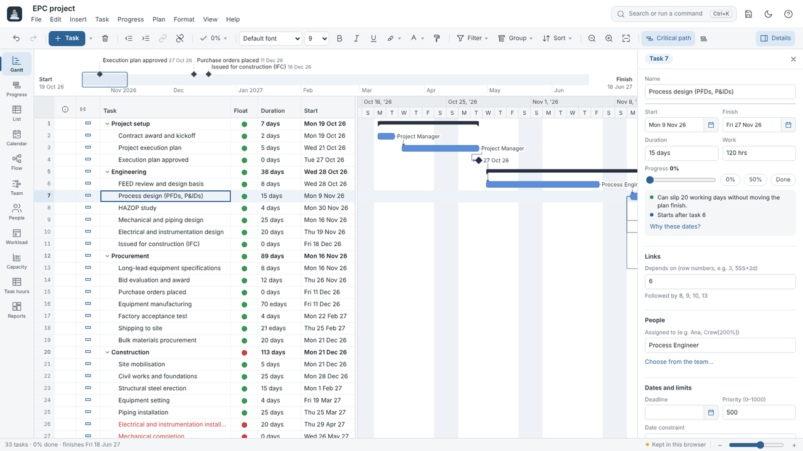
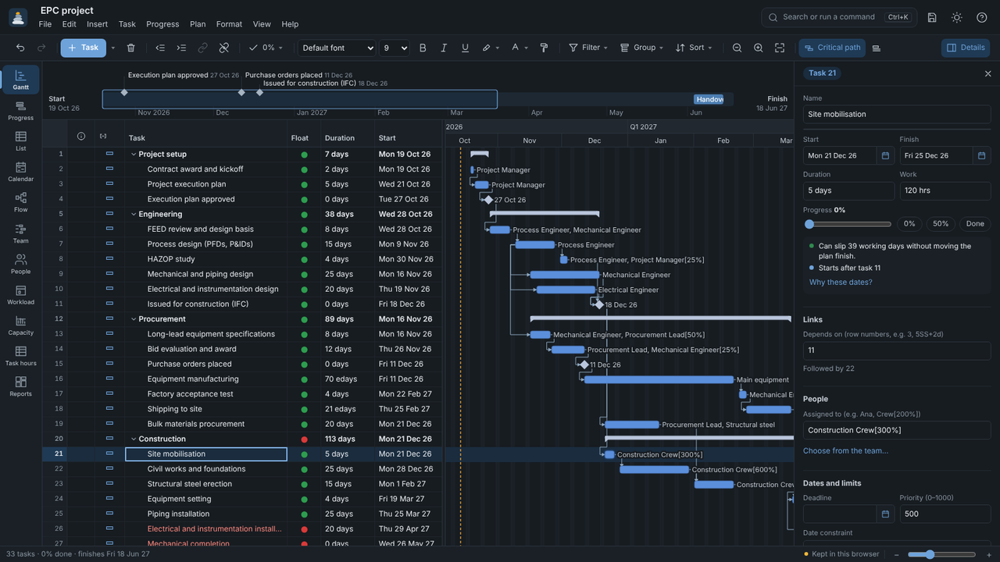
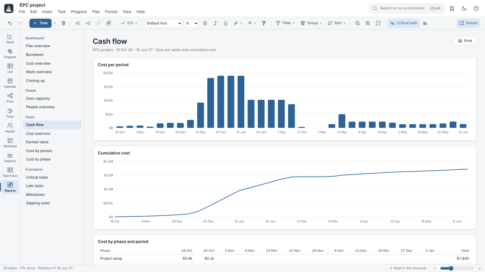
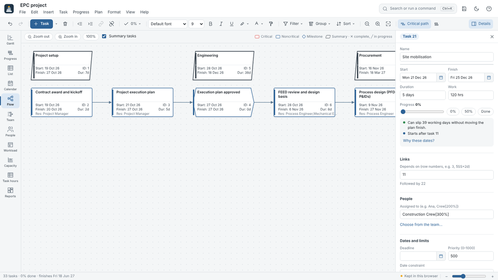
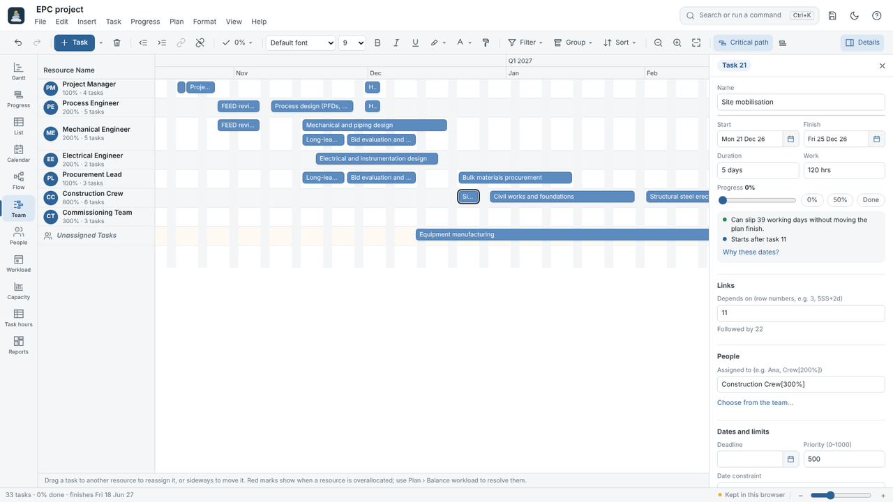
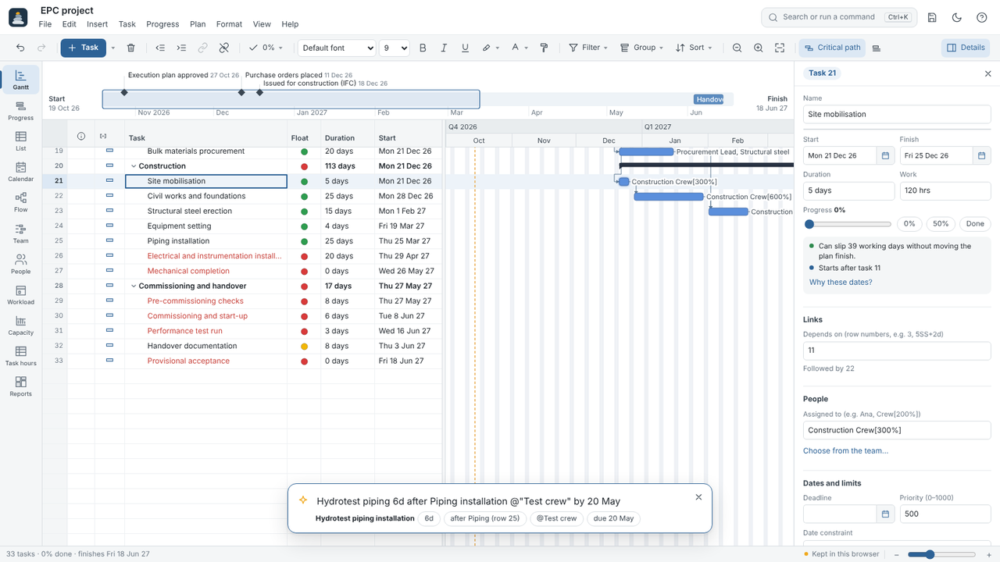
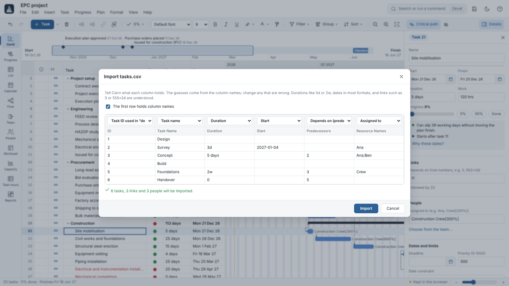

<div align="center">

<picture>
  <source media="(prefers-color-scheme: dark)" srcset="cairn-logo-light.svg">
  
</picture>

### Plan the path. Mark the milestones.

Cairn is a free, open-source project planner that runs in your browser.<br>
Gantt charts, linked tasks, critical path, people and costs, progress tracking and reports, with nothing to install.

[**Open Cairn**](https://edgar-mendonca.github.io/Cairn/) · [Download](https://github.com/edgar-mendonca/Cairn/releases/latest) · [What's new](CHANGELOG.md) · [Report a problem](https://github.com/edgar-mendonca/Cairn/issues)




</div>

## Why Cairn

- **Fast to learn.** A menu bar, one toolbar and a details panel. Press Ctrl+K and type what you want; press Ctrl+J and type a whole task in one line.
- **A real scheduling engine.** Working-time calendars, linked tasks with lags, constraints, critical path and float, effort-driven work, balancing over-capacity people, baselines and earned value, calculated to the minute.
- **Opens what you already have.** Project XML, Primavera P6 (.xer), MPX, Excel and CSV task lists, and it saves back to them.
- **Private by design.** No accounts, no server. Plans stay in your browser and in files you save. It works offline.
- **Open.** MIT-licensed TypeScript. The engine is separate from the interface and covered by tests.

## Get started

**Online:** open **[edgar-mendonca.github.io/Cairn](https://edgar-mendonca.github.io/Cairn/)**. Start from a blank plan or one of the five examples, or drop a file onto the window.

**On your computer:** download the ZIP from [Releases](https://github.com/edgar-mendonca/Cairn/releases/latest) and extract it.

| On | Do this |
| --- | --- |
| Windows | Double-click `Run Cairn.bat` (needs [Python 3](https://www.python.org/downloads/)) |
| macOS / Linux | Run `python3 run.py` in the extracted folder |
| Any system, quick look | Double-click `app/Open Cairn.html` |

Cairn opens at `http://127.0.0.1:8765/`. You can also install it from the browser menu to use it like a desktop app.

New to Cairn? Press **F1** for a ten-minute guide.

## What you can do

<table>
<tr>
<td width="50%" valign="top">

**Plan**
- Type tasks straight into the list, or add one per line with Quick add: `Pour slab 5d after 4 @Crew by 20 Mar`
- Phases (indent with Ctrl+]), milestones, repeating tasks, split tasks
- Links: finish-to-start, start-to-start, finish-to-finish and start-to-finish, with lags and leads
- Auto-scheduled or pinned tasks, date constraints and deadlines
- Calendars with working hours, holidays and repeating exceptions
- Schedule forward from a start date or back from a finish date

**People and costs**
- People, equipment, materials and cost items, with capacity that can change over time
- Rates that change over time, overtime, cost per use
- Workload and Capacity views show who is over capacity; Balance workload fixes it
- Work profiles (front-loaded, back-loaded, bell and more)

**Track**
- % done, actual dates, remaining work, mark as on schedule
- 11 baselines, date snapshots, progress lines, status date
- Earned value: SPI, CPI, EAC and more

</td>
<td width="50%" valign="top">

**See**
- Gantt, Progress against baseline, Task list, Calendar, Flow diagram, Timeline
- Team board (drag work between people), People, Workload, Capacity, Task hours
- Critical path, float bars, late tasks, task paths
- 16 reports: plan overview, burndown, cash flow, cost overruns, earned value, milestones and more
- A details panel that shows how far a task can slip and why it starts when it does

**Make it yours**
- Fonts, sizes, bold, colours and fills for cells, rows or columns; copy formatting
- Bar styles, bar colours, text styles, gridlines and a three-level timescale
- Columns sets, about 120 fields and 140 custom fields with formulas and indicators
- Filters, highlights, groups and sorting; save the views you use
- Light and dark themes

**Share**
- Save `.cairn` files; export to project XML, Primavera XER, Excel, CSV and calendar (.ics)
- Print with page setup and preview, or save as PDF
- Copy any view as a PNG or SVG image

</td>
</tr>
</table>

## Keyboard shortcuts

The ones you already know from other apps, plus a few for planning. Press **?** in Cairn for the full list.

| | | | |
| --- | --- | --- | --- |
| Search commands and tasks | Ctrl+K | Indent / outdent | Ctrl+] / Ctrl+[ |
| Quick add a task | Ctrl+J | Link / unlink tasks | Ctrl+L / Ctrl+Shift+L |
| New task below | Ctrl+Enter | Task details | Alt+Enter |
| Save / open / print | Ctrl+S / Ctrl+O / Ctrl+P | Web link | Ctrl+Shift+K |
| Undo / redo | Ctrl+Z / Ctrl+Y | Critical path | Alt+C |
| Find / replace / go to | Ctrl+F / Ctrl+H / Ctrl+G | Switch views | Alt+1 … Alt+9 |
| Bold / italic / underline | Ctrl+B / I / U | Zoom in / out / fit | Alt+= / Alt+- / Alt+0 |

On a Mac, use ⌘ in place of Ctrl.

## Files Cairn reads and writes

| Format | Open | Save |
| --- | :---: | :---: |
| Cairn plan (`.cairn`) | ✓ | ✓ |
| Project XML (`.xml`), the exchange format most desktop schedulers save | ✓ | ✓ |
| Primavera P6 (`.xer`) | ✓ | ✓ |
| MPX (`.mpx`) | ✓ | |
| Excel (`.xlsx`) and CSV task lists | ✓ | ✓ |
| Calendar (`.ics`): milestones and deadlines | | ✓ |
| PDF, PNG, SVG | | ✓ |

`.mpp` files use a closed binary format that browsers cannot read. Save them as XML in the program that made them (or open them in the free ProjectLibre and save as XML), then open the XML in Cairn.

## Screenshots

| | |
| --- | --- |
| <br>**Dark theme** | <br>**Reports** |
| <br>**Flow diagram** | <br>**Team board** |
| <br>**Quick add** | <br>**Importing a spreadsheet** |

## Examples to start from

| Example | What it covers |
| --- | --- |
| Engineering design | Requirements, concept and detailed design, prototype, testing and release |
| EPC project | Engineering, procurement with long-lead equipment, construction, commissioning and handover |
| Research project | Proposal and approvals, literature review, data collection, analysis and publication |
| Software development | Discovery, design, three build sprints, testing, launch and support |
| Building construction | Permits, substructure, superstructure, envelope, services, fit-out and handover |

## For developers

Cairn is TypeScript with React 19, built with Vite. You need [Node.js](https://nodejs.org/) 20.19 or newer.

```bash
git clone https://github.com/edgar-mendonca/Cairn.git
cd Cairn
npm install      # install the libraries
npm run dev      # development server: open http://localhost:5173/app.html
npm test         # engine tests
npm run build    # build the app into dist/
```

```
src/
├── engine/            scheduling engine: plain TypeScript, no interface code
│   ├── schedule.ts    forward and backward passes, critical path, float, costs
│   ├── calendar.ts    working time and exceptions (recur.ts for repeating rules)
│   ├── ops.ts         editing rules: what changes when you type in a cell
│   ├── level.ts       workload balancing
│   ├── timephase.ts   work and cost spread over time, work profiles
│   ├── fields.ts      field catalogue and custom fields; formula.ts runs formulas
│   ├── filters.ts     filters and groups
│   ├── projectxml.ts  project XML · xer.ts Primavera · mpx.ts · tabular.ts spreadsheets · ics.ts
│   ├── quickadd.ts    the one-line task parser
│   └── *.test.ts      tests
└── ui/
    ├── commands.ts    every command, its name, icon and shortcut, used by menus, toolbar and Ctrl+K
    ├── App.tsx        window, menu bar, toolbar, views, details panel
    ├── views/         workload, capacity, team board, flow, calendar, reports
    └── gantt/         bar drawing and the timescale
```

[`docs/scheduling-rules.md`](docs/scheduling-rules.md) lists the scheduling rules one by one, with what Cairn does for each.

The repository's `index.html` is the published app, a single self-contained file that GitHub Pages serves (Settings › Pages › Deploy from a branch › `main` › `/ (root)`). The source page is `app.html`: run `npm run dev` and open `/app.html` to develop. After a change, `npm run publish-site` rebuilds and copies the app to the repository root.

## Roadmap

- [ ] Plugins: add views, reports, fields and file formats without changing the core
- [ ] Scheduling each person on their own calendar
- [ ] Several plans sharing one pool of people
- [ ] Working on a plan together in real time

Ideas are welcome in [Issues](https://github.com/edgar-mendonca/Cairn/issues).

## Contributing

1. Fork the repository and create a branch.
2. Make your change. For scheduling changes, add a test in `src/engine/`.
3. Run `npm test` and `npm run lint`.
4. Open a pull request that explains what changed and why.

## Licence

[MIT](LICENSE). Use, change and share Cairn freely, also commercially. Names of other products and file formats are mentioned only to describe file compatibility.
